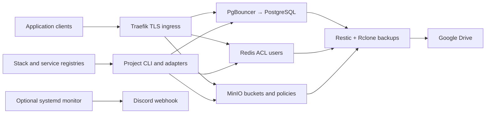

# Nguyen An Infrastructure

Reusable Docker Compose infrastructure for backend projects on Ubuntu 24.04. It runs Traefik, PostgreSQL with PgBouncer, Redis and MinIO; Bash scripts handle project isolation, backup, synchronization and optional monitoring. The design avoids a continuously running monitoring stack and has operated on a small VPS. Capacity depends on workload: **1 GiB RAM is an observed deployment, not a guaranteed minimum**.

This repository is for operators comfortable managing Linux, Docker, DNS and recovery credentials. Application deployment is outside its scope.

## Architecture



The four Compose project names are `infra-gateway`, `infra-database`, `infra-cache` and `infra-storage`. Traefik exposes HTTPS on 443, Redis TLS on 6380 and PostgreSQL TLS on 6433; administration ports bind to localhost. See [architecture](docs/ARCHITECTURE.md) for network and trust boundaries.

## Start here

1. Read [Quick Start](docs/QUICKSTART.md) for a clean Ubuntu host and DNS prerequisites.
2. Select [Standalone or GitOps deployment](docs/DEPLOYMENT.md). They must not manage the same stacks concurrently.
3. Use the [configuration reference](docs/CONFIGURATION.md) for environment files and secrets.
4. After installation, use [project management](docs/PROJECT-MANAGEMENT.md) to provision per-project credentials.

The bootstrap entry point is `sudo bash ./scripts/bootstrap.sh` from a trusted clone. It is interactive and intended for a clean or isolated recovery VPS. Do not rerun it on an existing production host. Backup and monitoring are optional.

## Features and limits

| Area | Implementation |
|---|---|
| Deployment | Standalone Docker Compose or GitOps with Dockhand and a systemd script synchronizer |
| Isolation | PostgreSQL database/role, Redis ACL user/key prefix, MinIO bucket/IAM policy per project |
| Backup | Sequential Restic snapshots through Rclone; Google Drive is supported |
| Monitoring | Optional five-minute systemd timer, host/service checks and Discord alerts |
| Extensibility | Validated JSON stack/service registries and allowlisted Bash adapters |

The project does not deploy application backends, provide per-tenant resource quotas, or make cross-service backups transactionally atomic. Full disaster recovery on an independent clean host remains **untested** (Phase 4.5 deferred). Backup creation and file-level restore have been exercised; those results do not prove complete recovery or a guaranteed RPO/RTO. See [backup and restore](docs/BACKUP-RESTORE.md).

## Repository map

```text
stacks/             Compose definitions
registry/           Stack and service metadata
scripts/core/       Shared configuration, registry and locks
scripts/setup/      Host installation and optional setup
scripts/deployment/ Standalone deployment and GitOps launcher/worker
scripts/projects/   Public project CLI and orchestration
scripts/services/   PostgreSQL, Redis and MinIO adapters
scripts/backup/     Aggregate backup and maintenance
scripts/restore/    Recovery orchestration
scripts/monitoring/ Optional checks, notifications and setup
configs/systemd/    Sync and monitoring service/timer units
tests/              Isolated regression tests and fixtures
docs/               Operator and contributor guides
```

## Documentation

- [Architecture](docs/ARCHITECTURE.md) · [Quick Start](docs/QUICKSTART.md) · [Deployment](docs/DEPLOYMENT.md) · [Configuration](docs/CONFIGURATION.md)
- [Project Management](docs/PROJECT-MANAGEMENT.md) · [Add a Service](docs/ADD-SERVICE.md) · [GitOps](docs/GITOPS.md)
- [Backup and Restore](docs/BACKUP-RESTORE.md) · [Disaster Recovery](docs/DISASTER-RECOVERY.md)
- [Monitoring](docs/MONITORING.md) · [Troubleshooting](docs/TROUBLESHOOTING.md) · [Security](docs/SECURITY.md)

CI checks Compose, Bash syntax, ShellCheck, registry fixtures, mock lifecycle tests, monitoring and Gitleaks before promoting `main` to `production`. It does not replace host-specific deployment and recovery testing. No release or license claim is made here.
