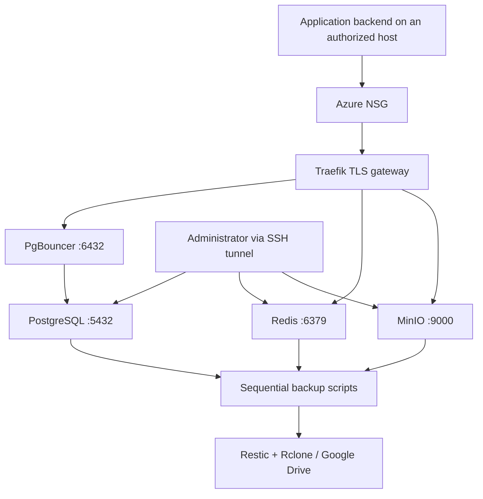
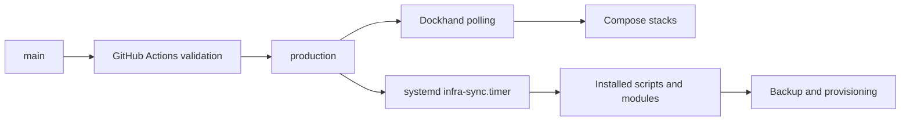

# Architecture

## Overview

Application hosting is outside this infrastructure scope; no Render or Vercel deployment is claimed.

## Host and services

Azure Ubuntu 24.04, Standard B2ats v2, 2 vCPU, 1 GiB RAM, 2 GiB swap. Public DNS under configured `INFRA_DOMAIN` (e.g. `example.com`). Subdomains: `postgres.${INFRA_DOMAIN}`, `redis.${INFRA_DOMAIN}`, `minio.${INFRA_DOMAIN}`. MongoDB is not running. Avoid adding heavyweight monitoring services to this host without load testing.

### Domain externalization

All infrastructure endpoint hostnames are dynamically derived from a single configuration variable: `INFRA_DOMAIN` (e.g., `example.com`):

- PostgreSQL / PgBouncer: `postgres.${INFRA_DOMAIN}:6433`
- Redis: `redis.${INFRA_DOMAIN}:6380`
- MinIO: `https://minio.${INFRA_DOMAIN}`

This configuration is decoupled:
- **Dockhand Stacks**: Receives `INFRA_DOMAIN` as an environment variable to interpolate Traefik router rules in `stacks/database.yml`, `stacks/cache.yml`, and `stacks/storage.yml`.
- **VPS Provisioning Scripts**: Reads `/opt/infra/infrastructure.env` safely via `scripts/lib/common.sh` (`load_infra_config`), ensuring new projects automatically receive connection strings for the current host domain without modifying source code.

| Stack | Service | Persistent storage |
|---|---|---|
| infra-gateway | Traefik | ACME certificate volume |
| infra-database | PostgreSQL 17, PgBouncer | PostgreSQL data volume |
| infra-cache | Redis 8 | Redis data volume (AOF, RDB, ACL) |
| infra-storage | MinIO | Object storage volume |
| standalone | Dockhand | dockhand_data |

## Networking

External Docker network `proxy` connects ingress-facing services to Traefik. PostgreSQL communicates with PgBouncer over the database stack network. Traefik terminates TLS for PostgreSQL and Redis TCP routers and MinIO HTTPS; PostgreSQL TLS uses the `postgres@file` TLS option with ALPN `postgresql`. Internal traffic after TLS termination is not necessarily encrypted.

## Isolation

PostgreSQL: database and login role per project, explicit CONNECT restrictions; PgBouncer dynamic auth uses a restricted authentication role and SECURITY DEFINER function in `postgres`. Redis: ACL user per project, command allowlist and key-prefix restriction; shared RAM and eviction policy are not per-project quotas. MinIO: private bucket and scoped IAM policy per project. None of these constitute hard resource isolation between tenants.

## Administrative forwarding

| Local port | VPS loopback port | Service |
|---|---|---|
| 15432 | 5432 | PostgreSQL |
| 16379 | 6379 | Redis |
| 13000 | 3000 | Dockhand |
| 9090 | 9090 | Cockpit |
| 8080 | 8080 | Traefik dashboard |
| 9000 | 9000 | MinIO API |
| 9001 | 9001 | MinIO Console |

Use localhost binding for tunnels. Keep administrative access separate from public application endpoints.

## Control plane

Dockhand and script sync are independent. Stack secrets remain in Dockhand or restricted local files. Script sync uses a read-only deploy key and installs allowlisted files, not arbitrary configuration or secrets; it does not update itself automatically. Provisioning is modular; each project has a protected `.env` and `project.json` service flags/status in `/opt/infra/projects/<name>/`.

## Resource baseline (24 November 2026)

| Component | Configured memory limit | Observed working usage |
|---|---:|---:|
| Redis | 128 MiB | 8.96 MiB |
| PgBouncer | 64 MiB | 0.85 MiB |
| PostgreSQL | 256 MiB | 5.91 MiB |
| Traefik | 128 MiB | 18.59 MiB |
| MinIO | 384 MiB | 85.39 MiB |
| Dockhand | No smaller explicit limit evidenced | 102.90 MiB |

Host: 836 MiB visible RAM, 389 MiB available; 497 MiB swap used out of 2 GiB; disk 8.7/29 GB used. This is an idle/low-load sample, not a capacity guarantee. Limits are not reserved RAM and their sum exceeds physical memory. Monitor swap activity and OOM events. Redis maxmemory 48 MiB, allkeys-lru; PostgreSQL shared_buffers 64 MB, max_connections 30; PgBouncer transaction pool, default pool size 5, max DB connections 10. MinIO restart policy was deliberately disabled in the earlier setup; review restart behavior before unattended recovery.
