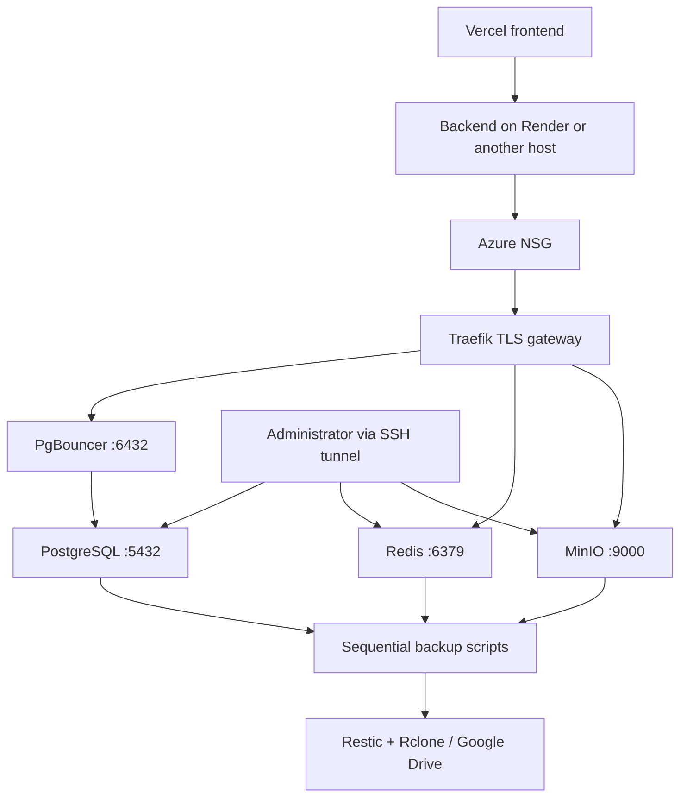

# Architecture

## Overview

Frontend/backend placement is the intended deployment model, not a verified production deployment.

## Host and services

Azure Ubuntu 24.04, Standard B2ats v2, 2 vCPU, 1 GiB RAM, 2 GiB swap. Public DNS under `static4j.app`. MongoDB is not running. Avoid adding heavyweight monitoring services to this host without load testing.

| Stack | Service | Persistent storage |
|---|---|---|
| infra-gateway | Traefik | ACME certificate volume |
| infra-database | PostgreSQL 17, PgBouncer | PostgreSQL data volume |
| infra-cache | Redis 8 | Redis data volume (AOF, RDB, ACL) |
| infra-storage | MinIO | Object storage volume |
| standalone | Dockhand | dockhand_data |

## Networking

External Docker network `proxy` connects ingress-facing services to Traefik. PostgreSQL communicates with PgBouncer over the database stack network. Traefik terminates TLS for PostgreSQL and Redis TCP routers and MinIO HTTPS; PostgreSQL TLS uses the `postgres@file` TLS option with ALPN `postgresql`. Internal traffic after TLS termination is not necessarily encrypted.

## Isolation

PostgreSQL: database and login role per project, explicit CONNECT restrictions; PgBouncer dynamic auth uses a restricted authentication role and SECURITY DEFINER function in `postgres`. Redis: ACL user per project, command allowlist and key-prefix restriction; shared RAM and eviction policy are not per-project quotas. MinIO: private bucket and scoped IAM policy per project. None of these constitute hard resource isolation between tenants.

## Administrative forwarding

| Local port | VPS loopback port | Service |
|---|---|---|
| 15432 | 5432 | PostgreSQL |
| 16379 | 6379 | Redis |
| 13000 | 3000 | Dockhand |
| 9090 | 9090 | Cockpit |
| 8080 | 8080 | Traefik dashboard |
| 9001 | 9001 | MinIO Console |

Use localhost binding for tunnels. Keep administrative access separate from public application endpoints.
