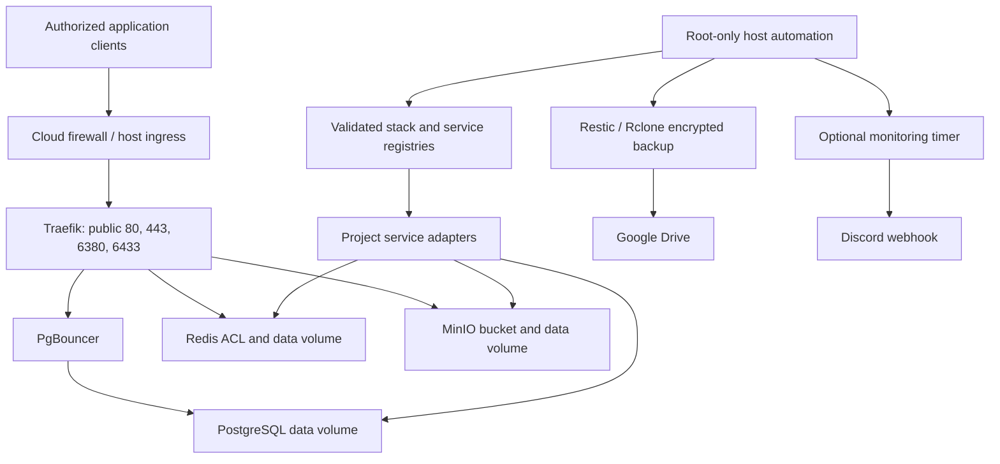
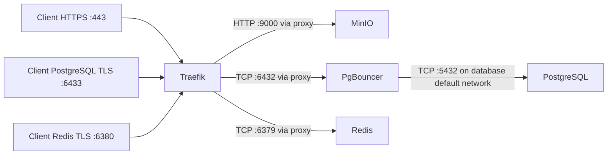
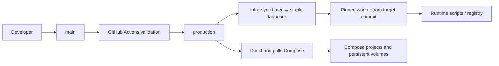
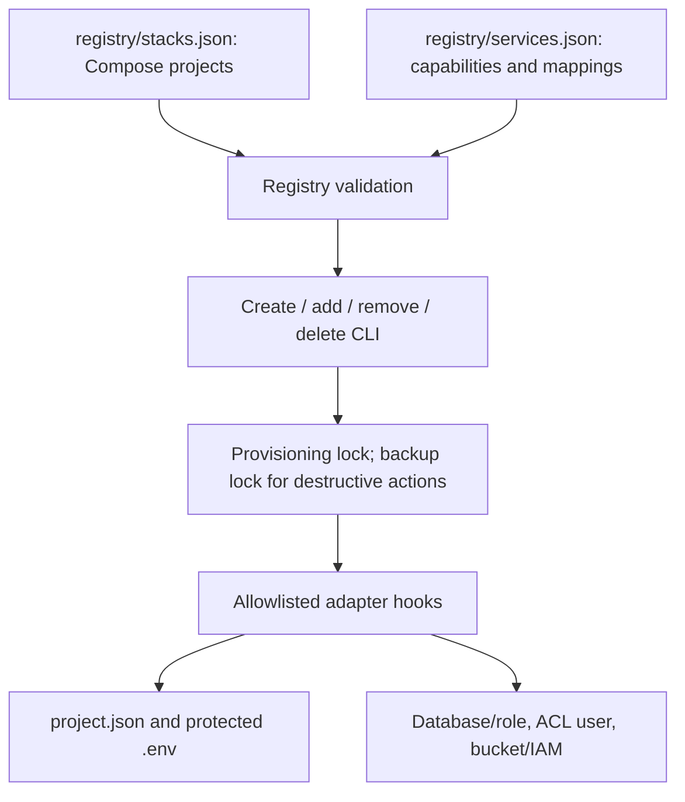
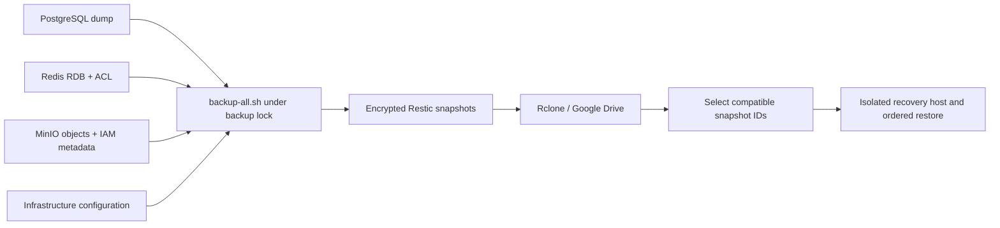
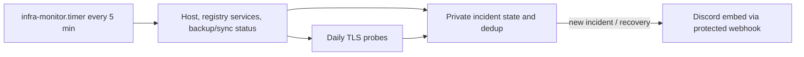

# Architecture

[README](../README.md) · [Configuration](CONFIGURATION.md) · [GitOps](GITOPS.md) · [Project Management](PROJECT-MANAGEMENT.md)

## Layers and trust boundaries

Applications are external to this repository. The `proxy` Docker network is external and joins Traefik to ingress-facing services; the database stack's default network joins PgBouncer to PostgreSQL. PostgreSQL is not directly on `proxy`. TLS ends at Traefik, so backend hops are not automatically encrypted. Root-only host scripts and protected secret files form a separate trust boundary from public ingress. Docker socket access gives Dockhand and host operators substantial control; limit who can administer the host and Git repository.

## Routing and service connectivity

Traefik's PostgreSQL router uses a protocol-specific TLS option (`postgres@file`, ALPN `postgresql`). Clients should verify the certificate and hostname. MinIO uses `minio.${INFRA_DOMAIN}`; Redis and PostgreSQL use their corresponding subdomains. The root domain is not an application HTTPS endpoint by default. Direct host mappings for PostgreSQL 5432, PgBouncer 6432, Redis 6379, MinIO 9000/9001 and the Traefik dashboard 8080 bind to `127.0.0.1`; Dockhand binds `127.0.0.1:3000`. Cockpit, when installed, uses 9090 and must be restricted by firewall policy. Do not treat a loopback port as public ingress.

## Deployment ownership and GitOps

Standalone mode uses `deploy.sh` for Compose ownership and optional manual `update.sh`; GitOps mode uses Dockhand for Compose and the systemd launcher/worker for installed scripts. Both modes share registry and adapters but must not control the same stacks at once. Docker stack polling and script synchronization are independent, not one atomic deployment. The installed revision is recorded in `/opt/infra/state/last-sync-commit`, not inferred from repository `HEAD`. See [GitOps](GITOPS.md).

## Registries and project lifecycle

The stack registry defines `infra-gateway`, `infra-database`, `infra-cache` and `infra-storage` with dependencies, containers, environment names and readiness handlers. The service registry maps PostgreSQL, Redis and MinIO capabilities to adapters, backup/restore hooks and managed runtime files. Registry paths, dependencies, identifiers, handlers and destinations are validated; metadata is not executed as shell. A registered service can be enabled as infrastructure without being provisioned for every project. PostgreSQL uses per-project database/role and CONNECT restrictions; Redis uses ACL users and key prefixes but shared memory/eviction; MinIO uses per-project private bucket and scoped IAM policy. These are logical access boundaries, not hardware isolation.

## Backup and recovery

Backup groups are sequential. `backup-status` records a complete aggregate success only when all required groups succeed. Restore requires the original repository credentials and a reviewed order; a file-level restore is not proof of complete service recovery. See [backup and restore](BACKUP-RESTORE.md) and [disaster recovery](DISASTER-RECOVERY.md).

## Monitoring and alerts

The monitor runs as a short root oneshot, never as a continuously running container. It does not restart services. A host-wide outage or network failure also prevents its Discord notification. See [monitoring](MONITORING.md).

## Resource considerations

The existing Compose files cap Redis at 128 MiB, PgBouncer at 64 MiB, PostgreSQL at 256 MiB, Traefik at 128 MiB and MinIO at 384 MiB. Those are limits, not reserved RAM. Docker, Dockhand, the OS, backups and workload need additional headroom. The setup script creates 2 GiB swap when none exists; swap is not a substitute for capacity testing. MinIO now uses `unless-stopped` restart policy. Validate under your own workload before selecting a VPS size.
