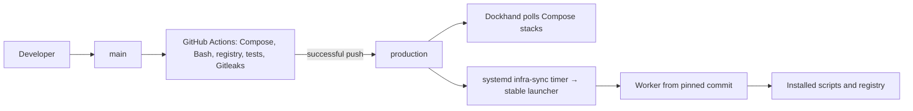

# GitOps Operations

[Architecture](ARCHITECTURE.md) · [Deployment](DEPLOYMENT.md) · [Launcher migration](SYNC-LAUNCHER-MIGRATION.md) · [Troubleshooting](TROUBLESHOOTING.md)



The workflow in `.github/workflows/infrastructure-ci.yml` validates pushes to `main` and pull requests; only a successful push to `main` promotes `HEAD` to `production`. Dockhand owns Compose stack reconciliation. Separately, `infra-sync.timer` invokes `/opt/infra/bin/sync-infra.sh` to fetch `production`, resolve one target commit and extract that commit's worker from `scripts/deployment/sync-infra.sh`. Neither process waits for or transactionally coordinates with the other: a stack and its scripts may temporarily be on different revisions. Validate compatibility before promotion.

The worker checks registry metadata and source files, builds a full installation plan, stages rollback copies, then installs managed runtime files. The registry is installed after dependent scripts. It updates `/opt/infra/state/last-sync-commit` only after post-install verification. This marker is the installed script revision; the repository checkout's `HEAD` is **not** proof of installation. `/opt/infra/state/sync-status` records `fetching`, `validating`, `syncing`, `postponed`, `synchronized`, `up-to-date`, `failed` or `recovery-required` with target/installed commit and timestamp.

The launcher has its own nonblocking lock. The worker uses sync, backup and provisioning locks in that order; contention postpones the attempt for a later timer run. During a partial install, the worker uses its transaction copies to roll back changed files. If rollback is incomplete, preserve `/opt/infra/state/sync-transaction` and inspect `recovery-required` before another attempt. Per-file replacement is atomic, but the entire deployment is not globally atomic. The launcher and systemd units are deliberately not self-updated.

Read-only status checks:

```bash
sudo systemctl status infra-sync.timer infra-sync.service --no-pager
sudo journalctl -u infra-sync.service -n 50 --no-pager
sudo cat /opt/infra/state/sync-status
sudo cat /opt/infra/state/last-sync-commit
git -C /opt/infra/repository rev-parse --verify 'origin/production^{commit}'
```

To request one synchronization after checking that no backup or provisioning task is active: `sudo systemctl start infra-sync.service`. This changes installed scripts; review the promoted commit first. For a failed sync, check repository access, worker availability, registry validation and lock owners before retrying. Do not delete a `sync-transaction` directory as a shortcut. [Troubleshooting](TROUBLESHOOTING.md) lists safe diagnostics. New optional stacks still require explicit Dockhand registration; a registry entry alone does not deploy containers.
